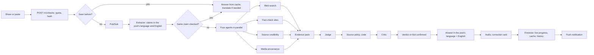

# CHCKR: fact checks in your own language

Team Frugalists, AI Builder Cup 2026. Share a WhatsApp forward or social post (text, photo, video, audio or a
link) into the app and get a verdict with credible sources, in the language of the post, as text and audio.
Hindi, Tamil, Kannada, Indonesian and English.

**Live app: https://chckr.web.app**

## For judges

**Sign in** with any Google account. Each account gets **10 checks a day** (answers from the cache and the
examples below do not use them). The app is a PWA and works best on an Android phone; it also works in a
desktop browser.

**Install and share from WhatsApp (Android):**
1. Open https://chckr.web.app in Chrome, sign in, then menu ⋮ → **Install app** (or "Add to Home screen").
2. In WhatsApp, long-press a message, photo or video → **Share** → pick **CHCKR**.
3. Watch the live progress screen, or leave it: a notification arrives when the answer is ready (about
   40 to 60 seconds for a new claim; a forward that was checked before answers in a second or two).

**Try an example:** the Home screen has five buttons (Flood video, Old photo, Fake quote, AI image, Scam
message) that answer real, earlier-checked shares from the cache.

**Paste one of these into the Home box** (expected labels from our acceptance cases):

| Language | Paste this | Expected |
| --- | --- | --- |
| Tamil | சூடான தண்ணீரில் எலுமிச்சை சாறு கலந்து குடித்தால் கொரோனா வைரஸ் அழியும். அனைவருக்கும் பகிருங்கள்! | FALSE |
| Hindi | प्रधानमंत्री मोदी सभी भारतीयों को 3 महीने का मुफ्त मोबाइल रिचार्ज दे रहे हैं। नीचे दिए गए लिंक पर क्लिक करके अभी अपना रिचार्ज पाएं, ऑफर सिर्फ आज तक! | SCAM |
| Indonesian | Vaksin COVID-19 mengandung microchip untuk melacak setiap orang yang sudah divaksin. Sebarkan ke semua grup sebelum dihapus! | FALSE |
| English | Chandrayaan-3's Vikram lander touched down near the Moon's south pole on 23 August 2023, making India the first country to land in that region. | TRUE |
| English (link) | https://www.bbc.com/news/world-asia-india-66594520 | TRUE |

**Where the evidence comes from:** Google Fact Check Tools API (ClaimReview from IFCN fact-checkers),
Grounding with Google Search, Cloud Vision web detection for photos (where else an image appeared, and
when), and a source tier list in [`config/source_tiers.yaml`](config/source_tiers.yaml): IFCN signatories,
wires and official sources are tier 1; established news is tier 2; social media is never a source.

**Guardrails:**
- The source policy is code, not a prompt ([`backend/app/verify/source_policy.py`](backend/app/verify/source_policy.py)):
  no TRUE, FALSE, MISLEADING or SCAM without 1 tier 1 or 2 independent tier 2 sources that confirm or
  contradict the claim; otherwise the answer is "Not confirmed". One narrow exception for low-harm claims: an
  evidence-score upgrade (at least two independent reports, none credible against, and the Critic agrees) can
  turn "Not confirmed" into TRUE ([decision 50](docs/16-decisions-log.md)). It never changes any other answer.
- Two reviewers: a Judge (Gemini 3.1 Pro) sees only the evidence pack, never the post's persuasion; a Critic
  checks the Judge. If they disagree, the answer is "Not confirmed" with both readings and all evidence shown.
- It abstains when evidence is thin, and every answer lists evidence for and against.
- Photos, videos and audio you share are deleted within 24 hours. See the
  [privacy policy](https://chckr.web.app/privacy) and [terms](https://chckr.web.app/terms).

**Known limits:**
- The share target is Android only (iOS Safari does not support Web Share Target); on iPhone, paste text or
  a link.
- Instagram, Facebook and TikTok links give the caption only (no video); share the video itself instead.
- A new claim depends on live search, so two fresh checks of the same claim can find different evidence; a
  repeat share is answered from the cache and stays consistent.

## How it works



Full design: [`docs/02-system-architecture.md`](docs/02-system-architecture.md) and the rest of `docs/` in
numeric order. Decisions and their reasons: [`docs/16-decisions-log.md`](docs/16-decisions-log.md).

## Layout

| Path | What |
| --- | --- |
| `backend/` | FastAPI API + pipeline (Python 3.12, `uv`). One image serves `/v1` and `/internal/pipeline` |
| `frontend/` | React + Vite + TS PWA with Web Share Target, Firebase Auth / Firestore / App Check, i18next (en, hi, ta, kn, id) |
| `config/` | Models and prices, limits, languages, fan-out agents, source tiers |
| `prompts/` | All model prompts, versioned, loaded at runtime |
| `scripts/` | GCP bootstrap, deploy scripts, model check, demo cache seeding |
| `eval/` | Eval runner (Cloud Run Job, every 3 days) |
| `tests/acceptance/` | The acceptance cases that define "working" (`make accept`) |
| `docs/` | Architecture docs |

## Set up and run

Google Cloud project with billing; everything runs on Google services.

1. **GCP and Firebase:** follow [`docs/11-gcp-setup-and-deploy.md`](docs/11-gcp-setup-and-deploy.md), then run
   `PROJECT_ID=<id> scripts/bootstrap_gcp.sh` (APIs, buckets with a 1-day media lifecycle, Pub/Sub, service
   accounts, Firestore vector index), then `scripts/create_bq_views.sh` for the BigQuery dashboards.
2. **Secrets** go to Secret Manager (and Codespaces secrets for local work), never into the repo:
   `FACTCHECK_API_KEY` for the backend; `VITE_FIREBASE_API_KEY`, `VITE_FIREBASE_APP_ID`,
   `VITE_FIREBASE_VAPID_KEY`, `VITE_RECAPTCHA_ENTERPRISE_SITE_KEY` for the PWA build.
3. **Check the models** exist in Vertex AI: `make check-models` (IDs live only in `config/models.yaml`).
4. **Run locally** (the devcontainer works in GitHub Codespaces or VS Code):

```bash
gcloud auth application-default login   # once per container
make dev           # backend :8080 + PWA :5173 against the dev Firestore DB and real Gemini
make dev-offline   # no GCP: in-memory store, fake sign-in, recorded model fixtures
make test          # ruff + pytest (no paid calls) + frontend typecheck
make accept        # acceptance cases against real models (costs money)
make hooks         # pre-commit check that blocks secrets and private folders
```

5. **Deploy:** `make deploy`, or push to `main` (Cloud Build trigger `deploy-on-push`: secret scan, tests,
   backend to Cloud Run, PWA to Firebase Hosting). `scripts/seed_demo_cache.py --seed` fills the demo cache.

Configuration precedence: environment variables, then a gitignored override file (`backend/.env`,
`frontend/.env.development.local`), then the committed non-secret defaults (`backend/.env.defaults`,
`frontend/.env.development`).

## License

[Apache 2.0](LICENSE).
