# 02. System architecture

## Components

| Component | Runs on | Job |
| --- | --- | --- |
| PWA | Firebase Hosting | Share target, sign-in, upload, live progress, verdict, history, result page |
| API service `factcheck-api` | Cloud Run, asia-south1 | Auth, quota, intake, tier 1 cache, creates check, publishes job |
| Pipeline endpoint | Same Cloud Run service, `/internal/pipeline` | Receives Pub/Sub push, runs the full pipeline for one check |
| Pub/Sub topic `check-jobs` | Pub/Sub | Decouples intake from long pipeline runs; push subscription with OIDC auth |
| Firestore (Native, asia-south1) | Firestore | Checks, verdicts, cache, vector index, users, quotas, sources, config |
| Cloud Storage `{project}-media` | asia-south1 | Raw uploads, 24 h lifecycle delete |
| Cloud Storage `{project}-outputs` | asia-south1 | Audio and card images, kept with verdicts |
| Vertex AI Gemini | `global` endpoint | Flash for extraction and sub-agents, Pro for Judge and Critic, embeddings |
| Gemini TTS | Cloud Text-to-Speech API | Native-language audio |
| Cloud Vision | API | Web detection (reverse image search) |
| Fact Check Tools API | API key in Secret Manager | Published fact checks by text and image |
| BigQuery dataset `factcheck` | asia-south1 | check_runs, model_calls, eval_runs |
| Cloud Scheduler + Cloud Run Job `eval-runner` | asia-south1 | Eval every 3 days |
| Firebase Auth, App Check, FCM | Firebase | Google sign-in, abuse protection, web push |

One container image serves both the public API and the pipeline endpoint. This keeps deploys simple. Pub/Sub push means the pipeline runs inside a normal request, so Cloud Run CPU is allocated for the whole run (no background-thread problems). Set Cloud Run request timeout to 300 s, concurrency 10, min instances 1 during the judging window (cold starts hurt the demo), 0 otherwise.

## Request flow

```mermaid
flowchart LR
  U[User shares post] --> P[PWA share target]
  P -->|upload + ID token + App Check| A[POST /v1/checks]
  A --> Q{Quota ok?}
  Q -- no --> X[429 limit reached]
  Q -- yes --> H[Hash media + text]
  H --> C1{Tier 1 exact hit?}
  C1 -- yes --> R[Return cached verdict, translate + TTS if new language]
  C1 -- no --> J[Create check doc, publish to Pub/Sub]
  J --> PL[/internal/pipeline/]
  PL --> L{Link?}
  L -- yes --> F[Fetch post ladder]
  L -- no --> E
  F --> E[Extractor: claims in original language + English]
  E --> C2{Tier 2 semantic hit?}
  C2 -- near match --> NM[Quick match check, Flash]
  NM -- same claim --> R
  NM -- different --> FO
  C2 -- no --> FO[Fan-out in parallel]
  FO --> S1[Web search agent]
  FO --> S2[Fact-check sites agent]
  FO --> S3[Source credibility agent]
  FO --> S4[Media provenance agent]
  S1 & S2 & S3 & S4 --> PK[Evidence packager]
  PK --> JD[Judge, Pro]
  JD --> SP[Source policy check, code]
  SP --> CR[Critic, Pro]
  CR --> M{Agree?}
  M -- yes --> V[Final verdict]
  M -- no --> JR[Judge revision] --> V2{Matches critic?}
  V2 -- yes --> V
  V2 -- no --> NE[NOT_ENOUGH_EVIDENCE + both sides]
  V & NE --> CO[Composer: native text + English + audio script]
  CO --> T[Gemini TTS] & CD[Correction card]
  T & CD --> W[Write verdict + cache + BigQuery]
  W --> N[Firestore update drives live screen; FCM push if backgrounded]
```

## Live progress

The PWA subscribes to `checks/{check_id}` with Firestore `onSnapshot`. Each stage writes `stage`, `stage_label_key`, `progress` (0 to 100) and partial results. Stages in order:

`received → cache_lookup → fetching_link → extracting → searching (sub-agent ticks) → packaging → judging → reviewing → composing → speaking → done` (or `failed`, `limit`).

The verdict text is written as soon as the composer finishes; audio and card URLs are added a few seconds later. The screen shows the verdict without waiting for audio.

Push: the service worker reports visibility. The backend sends an FCM message on `done` only if the client marked the check `background: true` (set on `visibilitychange`) or the snapshot listener is not active. Keep it simple: always send push on done; the service worker suppresses the notification if a visible client exists.

## Latency budget (new claim, images or text)

| Stage | Target | Hard timeout |
| --- | --- | --- |
| Upload + hash + tier 1 | 2 s | 5 s |
| Link fetch (if link) | 4 s | 10 s |
| Extraction | 8 s | see video rule |
| Embedding + tier 2 + near-match check | 3 s | 6 s |
| Fan-out (4 agents in parallel) | 20 s | 28 s each |
| Packager | 5 s | 10 s |
| Judge | 12 s | 20 s |
| Critic | 8 s | 15 s |
| Judge revision (only on disagreement) | 10 s | 15 s |
| Composer | 5 s | 10 s |
| TTS and card (parallel) | 6 s | 12 s |
| Total | about 70 to 85 s | 90 s base budget |

Video and audio rule: Gemini tokenizes video at about 300 tokens per second at default resolution and about 100 at low resolution, plus audio. We use low media resolution for videos over 60 s. A 3 minute video is about 18k to 54k tokens; expect extraction of 15 to 40 s. Extraction timeout = 15 s + 0.2 s per second of media (3 min video: 51 s). Total budget = 90 s + (extraction timeout minus 15 s). Measure on Day 1 with 10 sample videos and adjust `config/limits.yaml`.

On timeout:
- A sub-agent timeout: continue with the others; packager notes the missing lane
- Judge or Critic timeout: retry once on Flash with the same prompt, mark `degraded: true`
- Whole budget exceeded: return NOT_ENOUGH_EVIDENCE with the partial evidence, then run one background retry with a 120 s budget. If the retry gets a different verdict, update the check and push "Updated result". Retries do not count against the user's quota

## Local development

Rohit's laptop runs backend (`uvicorn`) and frontend (`vite`) together. Backend uses Application Default Credentials against the real GCP project and the Firestore database named `dev-db` (database IDs need at least 4 characters). Set `PIPELINE_MODE=inline` locally to run the pipeline in the same process right after `POST /v1/checks` instead of via Pub/Sub. In Cloud Run `PIPELINE_MODE=pubsub`.

For Web Share Target testing on a phone, the PWA must be served over HTTPS and installed. Use the Firebase Hosting preview channel (`firebase hosting:channel:deploy dev`) pointing at the local backend through a tunnel, or deploy the backend to a `dev` Cloud Run service.

## Future-ready seams

- `pipeline.run_check()` takes a `CheckRequest` and returns a `CheckResult` with no web-specific types, so a WhatsApp bot, mobile app or B2B API can call it
- The fan-out list comes from `config/agents.yaml`. Replacing it with an LLM router later changes one function
- API is versioned (`/v1/`) from day one
